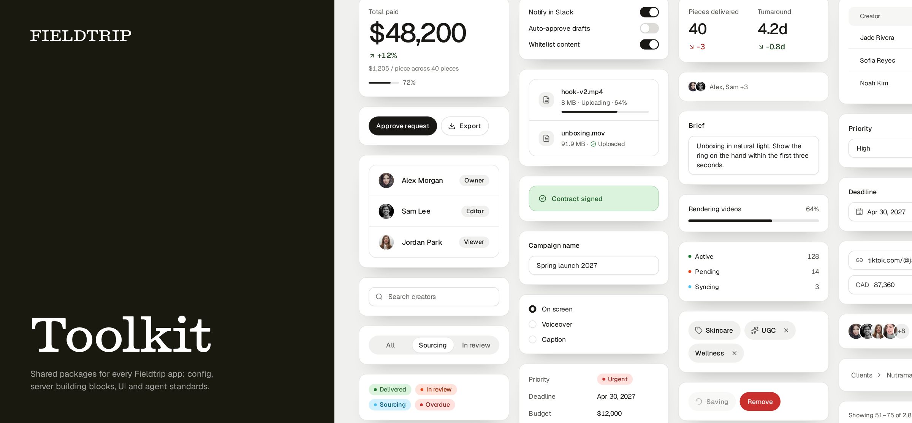

<picture>
  <source media="(prefers-color-scheme: dark)" srcset=".github/assets/fieldtrip-logo-light.svg">
  
</picture>

Shared packages for every Fieldtrip app: config, server building blocks, UI and agent standards.



## Packages

| Package | What's in it |
| --- | --- |
| `@fieldtripagency/config` | tsconfig, Biome, dependency-cruiser, Vitest and commitlint presets |
| `@fieldtripagency/core` | Framework-free primitives: errors, results, logger, env schemas |
| `@fieldtripagency/next` | Next.js pieces: `action()`, `route()`, Sentry, rate limiting, security headers, fonts |
| `@fieldtripagency/ui` | Design tokens and components (Radix + Tailwind v4), shipped as source |
| `@fieldtripagency/standards` | The `ft` CLI and the agent rules and skills every app shares |

`packages/standards/template` is the base app (no authentication). When in doubt about how something is wired, look there.

## Start a project

```sh
bun add -g @fieldtripagency/standards   # installs `ft`; ~/.bun/bin must be on PATH
```

Then, for every project:

```sh
ft create my-app              # or: bunx @fieldtripagency/standards create my-app
cd my-app && bun dev
```

Open any AI tool in the project and describe what to build. `AGENTS.md` tells it to record the
brief and which guides to read, so you add no extra context.

`ft create <dir> [--local]` creates the base app. It copies the template, sets the package name, runs `git init` and `bun install`, and syncs the managed `AGENTS.md` block. `<dir>` may be `.` or an existing folder as long as none of the template's paths exist in it.

- `--local` is for developing the toolkit: it runs `bun run pack:local` and points `@fieldtripagency/*` at `.packs/*.tgz` by absolute path, so never commit that `package.json`.

### Ship it

The app ships `.github/workflows/ci.yml`, which calls the toolkit's reusable `verify.yml` (biome, tsc, lint:arch, tests, `ft check`, gitleaks).

```sh
gh repo create Genoux/my-app --private --source . --push
npx vercel link
```

Production is gated by a Vercel Deployment Check. On `vercel.deployment.ready` the app's `ci.yml` calls the reusable `release-gate.yml`, which re-verifies the deployed commit and sets the `release` commit status; Vercel holds the production deployment until it succeeds.

One-time Vercel setup, in this order (until the check exists, production deploys ungated):

1. Project → Settings → Build and Deployment → Deployment Checks → Add → GitHub → `release`.
2. Keep production auto-aliasing on.

Apps with a database pass `with: { db-check: true }` to `verify.yml`, and `with: { db-check: true, migrate: true }` plus `secrets: { DATABASE_URL: ... }` to `release-gate.yml` (add `environment:` to read environment-scoped secrets). Rollback is Vercel Instant Rollback.

### AI tool access (MCP)

`ft mcp` writes MCP server config for the AI tools you pick, from a curated list of official remote servers: Vercel, Sentry, Neon, Clerk, Cloudflare. GitHub is left out: its MCP server needs a personal access token outside VS Code, and the authenticated `gh` CLI covers the same ground. Run it from the app directory and choose freely; pick with arrows and space, Enter confirms; what is already configured is pre-selected.

```sh
ft mcp                                               # arrow-key picker: tools, then servers
ft mcp --tools claude,cursor --servers vercel,sentry # non-interactive
```

Tools: `claude` (`.mcp.json`), `cursor` (`.cursor/mcp.json`), `vscode` (`.vscode/mcp.json`), `codex` (`.codex/config.toml`), `gemini` (`.gemini/settings.json`). Only curated server entries are managed: your own entries and other keys are left alone, and curated servers you deselect are removed. No secrets are written; authenticate each server in your AI tool on first use.

## Use it in an app

Packages are public on npmjs.org; no registry config or token is needed.

```sh
bun add @fieldtripagency/core @fieldtripagency/next @fieldtripagency/ui geist
bun add -d @fieldtripagency/config @fieldtripagency/standards
```

Then:

- `tsconfig.json` extends `@fieldtripagency/config/tsconfig/nextjs.json`
- `next.config.ts` has `transpilePackages: ["@fieldtripagency/ui"]` (core and next ship compiled JS), and `geist` is a dependency (`@fieldtripagency/next/fonts` loads it)
- `vitest.config.ts` spreads `vitestPreset` from `@fieldtripagency/config/vitest`, which runs `@fieldtripagency/*` through Vite so mocks and aliases apply (alias `server-only` to a stub, see the template). Only code that runs outside Vite (e.g. workflow step bundles) needs `execArgv: ["--conditions=react-server"]`
- `biome.json` extends `@fieldtripagency/config/biome`
- `globals.css` imports `@fieldtripagency/ui/theme.css`, and `@fieldtripagency/ui/fieldtrip.css` after it when the app carries the Fieldtrip brand (palette and brand fonts; the app loads the licensed font files)
- the root layout puts `fontVariables` from `@fieldtripagency/next/fonts` on `<html>`
- `bunx ft sync` writes the shared agent rules and downloads the latest shared third-party skills; `bunx ft check` fails CI when the rules drift

### Shared skills

`packages/standards/external-skills.txt` lists third-party skills every app gets (design, animation, code, workflow). `ft create` and `ft sync` download the latest version of each from GitHub into the app's `.agents/skills/`, which Codex, Cursor, Gemini CLI, Copilot and OpenCode read, and link each one into `.claude/skills/` for Claude Code (a copy where links are not allowed). They are never committed: the app's `postinstall` runs `ft sync`, so `bun install` after a clone fetches them (skipped when `CI` is set). A folder without the `.toolkit-source` marker is the app's own and is never replaced. A failed download only warns, and removes nothing. To add or drop a skill, edit the list and release `@fieldtripagency/standards`.

## Develop

```sh
bun install
bun run storybook   # components at localhost:6006
bun run check       # types, tests, architecture rules, lint
```

To try a change inside an app before releasing it:

```sh
bun run sync ../ugc-hub --watch
```

This copies the package sources into the app's `node_modules` on every save. If you added a dependency to a package, `bun add` it in the app too; sync warns when that happens.

## Release

Versions come from PR titles. Merges are squash-only, so the title becomes the commit:

| Title | Release |
| --- | --- |
| `fix(ui): …` | patch |
| `feat(next): …` | minor |
| `feat(ui)!: …` | major (minor while below 1.0) |
| `chore:`, `docs:`, `ci:` … | none |

Merging to `main` keeps a release PR up to date with the next version and changelog. Merging that PR publishes every package at the same version.

Publishing uses npm trusted publishing (GitHub OIDC from `release.yml`); there is no npm token. A new package needs one manual publish before its trusted publisher can be added (`npm trust github <package> --file release.yml --repo Genoux/ft-toolkit --allow-publish`).

Experimental builds: run "Release packages" from the Actions tab on any branch with `channel: experimental` (pushes to the branches listed in `release.yml` do it automatically). Every package is published as `<next minor>.0-experimental.<run number>` under the `experimental` dist-tag, never `latest`; an app tries it with `bun add @fieldtripagency/ui@experimental`.

### Moving an app from `@inbeat/*`

The packages were published as `@inbeat/*` up to 0.19.1 and continue as `@fieldtripagency/*`; the repo moved from `ib-toolkit` to `ft-toolkit` and the CLI from `ib` to `ft`. In the app:

1. Swap every `@inbeat/` dependency, import and preset path for `@fieldtripagency/`.
2. In `package.json` scripts, `ib sync` and `ib check` become `ft sync` and `ft check` (including `postinstall`).
3. In `.github/workflows/ci.yml` and `renovate.json`, `Genoux/ib-toolkit` becomes `Genoux/ft-toolkit`.
4. `bun install`. The `postinstall` sync swaps the old `ib:standard` block in `AGENTS.md`, replaces the `ib-*` skills with `ft-*`, and renames `.ib-spacing-baseline`.

## Rules

- UI conventions live in `packages/standards/skills/ft-ui/SKILL.md`. Read it before adding a component.
- One story per component in `packages/ui/stories`. What Storybook shows is what apps get.
- Apps change the look through tokens (see "Look" in the `ft-ui` skill) and component props, never by restyling toolkit components.
